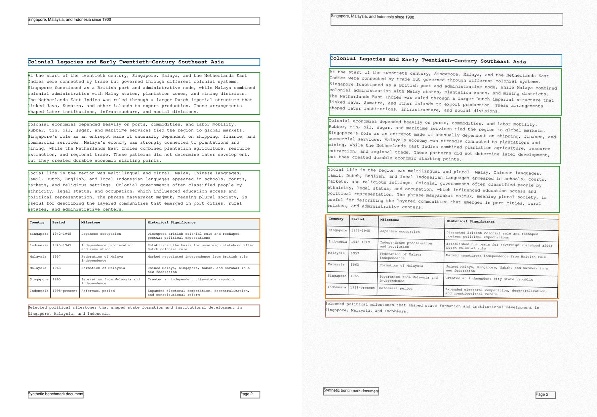
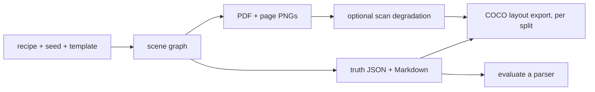

# synthetic-pdf-bench

Generate synthetic documents with exact ground truth, to train layout and reading-order models and to test PDF ingestion pipelines (RAG, extraction, OCR).

Labels come from the scene graph each PDF is rendered from, never from parsing the output, so boxes, reading order, tables and Markdown always match the pixels. Layouts, scan degradation and train/val/test splits are seeded and reproducible.





Planned next: `.pptx`, `.docx` and `.xlsx` documents (with PDF exports). See [docs/roadmap.md](docs/roadmap.md).

## Quick start

```bash
uv sync
uv run synthetic-pdf-bench --output output/doc_1 --seed 123 --recipe data/recipes/canonical/sea_historical_report_v1.json
```

This writes `output/doc_1/document.pdf` and a `truth/` folder with `document.json`, `document.md`, `manifest.json`, `pages/page_001.png`, and `figures/*.png`.

## Usage

**A training corpus with leakage-safe splits and COCO labels**

```bash
uv run synthetic-pdf-bench --output-root output/corpus --count 200 --workers 8 \
  --variants random standard --recipe data/recipes/canonical/sea_historical_report_v1.json \
  --recipe data/recipes/canonical/singapore_history_1900_2020s_v1.json \
  --recipe data/recipes/canonical/malaysia_history_1900_post_2018_v1.json \
  --splits train=0.7 val=0.15 test=0.15 --split-by recipe
uv run synthetic-pdf-bench export-coco output/corpus   # coco_train.json, coco_val.json, coco_test.json
```

Whole groups go to one split (`--split-by recipe|template|document`), so the same text or layout never lands in both train and test. With few recipes the realized proportions are coarse, and generation fails rather than leak if there are fewer groups than splits. `random` gives every document its own page template. Annotations use DocLayNet-style classes with a per-page `reading_order`.

**Scanned documents for OCR testing**

```bash
uv run synthetic-pdf-bench --output output/scan_1 --seed 3 --degrade heavy_scan   # or light_scan
```

`document.pdf` becomes an image-only scan (no text layer) and the digital original is kept as `document_clean.pdf`. `bbox_px` and the COCO boxes follow the skewed pages; `bbox_pt` still describes the digital PDF.

**Scoring a parser**

```bash
uv run synthetic-pdf-bench evaluate --truth output/doc_1/truth --prediction path/to/parser/output
```

Reports Markdown match and token F1, block and figure box IoU, and table matrix match. The prediction format and other commands are in [docs/reference.md](docs/reference.md) and [docs/parser-pipeline-guide.md](docs/parser-pipeline-guide.md).

## Contributing

See [CONTRIBUTING.md](CONTRIBUTING.md). Project status and plan: [docs/implementation-status.md](docs/implementation-status.md), [docs/roadmap.md](docs/roadmap.md).

## License

[Apache 2.0](LICENSE)
