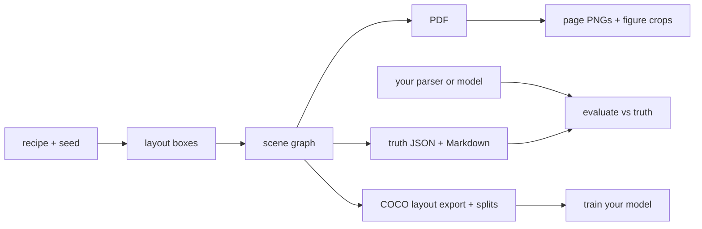

# synthetic-pdf-bench

Generate synthetic PDFs with exact labels, to train and evaluate Docling-style document models: layout detection, reading order, table structure and PDF-to-Markdown.

The truth (text, reading order, coordinates, tables, figures, Markdown spans) comes straight from the scene graph the PDF is rendered from. It is never recovered by parsing the output PDF, so it cannot be wrong.



## Quick start

```bash
uv sync
uv run synthetic-pdf-bench --output output/synthetic_000001 --seed 123 --recipe data/recipes/canonical/sea_historical_report_v1.json
```

This writes one document directory:

```text
output/synthetic_000001/
  document.pdf
  truth/
    document.json
    document.md
    manifest.json
    pages/page_001.png
    figures/*.png
```

The default generator loads the canonical Southeast Asia historical recipe from `data/recipes/canonical/sea_historical_report_v1.json` and naturally flows it across 3-8 pages. The layout planner creates deterministic boxes for titles, headings, paragraphs, tables, table cells, raster figures, vector figures, captions, repeated headers, footers, and page numbers.

## Dataset generation

Generate a small dataset with deterministic seeds and recipe/layout variants:

```bash
uv run synthetic-pdf-bench \
  --output-root output/small_dataset \
  --count 5 \
  --seed-start 100 \
  --recipe data/recipes/canonical/sea_historical_report_v1.json \
  --variants standard compact text_heavy figure_heavy table_heavy
```

Dataset mode writes:

```text
output/small_dataset/
  manifest.json
  synthetic_000001/
  synthetic_000002/
  synthetic_000003/
```

Available variants are `standard`, `compact`, `spacious`, `text_heavy`, `figure_heavy`, `table_heavy`, `two_column`, and `random`. `random` samples a whole page template from the seed (page size, margins, type sizes, font family, 1 or 2 columns, page-number position) and records it in `truth/document.json` under `metadata.layout_style`.

Each document manifest includes a `quality` report. The dataset manifest includes aggregate `summary_stats` for pages, blocks, tables, figures, and variant counts.

## Layout features

The flow layout engine uses ReportLab font metrics for text height estimation and supports:

- one-column and two-column page flow
- repeated headers, footers, and page numbers
- section page-break hints
- paragraphs, lists, tables, figures, captions, footnotes, and references
- split table segments when a table does not fit in the current column/page
- figure captions before or after figures
- page-level validation for bounds and content-block overlap

## Visual benchmark recipe

`data/recipes/canonical/visual_benchmark_v1.json` exercises visual extraction with deterministic matplotlib chart figures and richer table shapes.

Supported matplotlib chart kinds:

- `bar_chart`
- `line_chart`
- `stacked_bar`
- `timeline`
- `scatter_plot`
- `heatmap`

Supported table variants:

- narrow table
- wide table
- numeric table
- multilingual table
- wrapped cell text
- merged cells (real `rowspan`/`colspan`: spanned positions have no cell of their own, and the table HTML carries the spans)
- multi-page table splitting

## Benchmark evaluation

Expected parser output directory shape:

```text
prediction/
  document.md          # predicted Markdown, optional if prediction.json has markdown
  prediction.json      # structured prediction
  figures/*.png        # optional extracted figure files
```

Minimal `prediction.json` shape:

```json
{
  "doc_id": "optional",
  "markdown": "# Predicted Markdown",
  "blocks": [
    {"block_id": "b000001", "type": "paragraph", "page_index": 0, "bbox_pt": [72, 100, 540, 130]}
  ],
  "tables": [
    {"table_id": "tbl_001", "matrix": [["A", "B"]], "page_index": 0, "bbox_pt": [72, 100, 540, 160]}
  ],
  "figures": [
    {
      "figure_id": "fig_001",
      "page_index": 0,
      "bbox_pt": [72, 200, 540, 360],
      "markdown_ref": "",
      "png_path": "figures/fig_001.png"
    }
  ]
}
```

Run the evaluator:

```bash
uv run synthetic-pdf-bench evaluate \
  --truth output/synthetic_000001/truth \
  --prediction path/to/parser/output \
  --output output/synthetic_000001/evaluation.json
```

Metrics include normalized Markdown exact match, Markdown token F1, block bbox IoU, table matrix exact match, figure count match, figure bbox IoU, and figure Markdown reference match.

For smoke testing the evaluator, generate a truth-copy dummy prediction:

```bash
uv run synthetic-pdf-bench dummy-parse \
  --truth output/synthetic_000001/truth \
  --prediction output/synthetic_000001/dummy_prediction
```

## Parallel generation and leakage-safe splits

```bash
uv run synthetic-pdf-bench --output-root output/corpus --count 200 --workers 8 \
  --variants random standard --recipe data/recipes/canonical/a.json --recipe data/recipes/canonical/b.json \
  --splits train=0.8 val=0.1 test=0.1 --split-by recipe
uv run synthetic-pdf-bench export-coco output/corpus     # coco_train.json, coco_val.json, coco_test.json
```

`--splits` writes `splits.json` and tags each document in the manifest. Whole groups go to one split, chosen by `--split-by`: `recipe` (same text source, the default), `template` (same page layout), or `document` (can leak text across splits). With only a few groups the realized proportions are coarse (4 recipes cannot make a 90/5/5 split); if there are fewer groups than splits, generation fails instead of leaking. Output is identical for any `--workers` value.

## Scan degradation

```bash
uv run synthetic-pdf-bench --output output/scan_1 --seed 3 --degrade heavy_scan   # or light_scan
```

Page images get per-page skew, shift, contrast loss, blur, noise and JPEG artifacts. `document.pdf` becomes an image-only scan (no text layer, so OCR is needed) and the digital original is kept as `document_clean.pdf`. `bbox_px` in the truth and COCO export follow the degraded pages; `bbox_pt` and `bbox_norm` still describe the digital PDF, and figure crops stay clean. Boxes are axis-aligned around the skewed content, so they are a little looser than the text.

## Layout-detection export

```bash
uv run synthetic-pdf-bench export-coco output/small_dataset   # writes output/small_dataset/coco.json
```

Boxes use DocLayNet-style classes, with a per-page `reading_order` on each annotation.

## Quality controls

Generation runs quality validation before writing the final manifest. The checks verify:

- all blocks have bounding boxes
- included Markdown blocks have valid spans
- figure caption links resolve
- table cells stay inside table bounding boxes
- content blocks do not overlap
- rendered page images exist and are nonblank
- figure crops exist and are nonblank

## Fonts

The ReportLab renderer automatically uses the built-in `STSong-Light` CID font for text containing Chinese characters. Latin-only text uses Helvetica by default. Future phases can add configurable external fonts such as Noto Sans CJK for higher visual fidelity.

## Contributing

See [CONTRIBUTING.md](CONTRIBUTING.md).

## License

[Apache 2.0](LICENSE)
