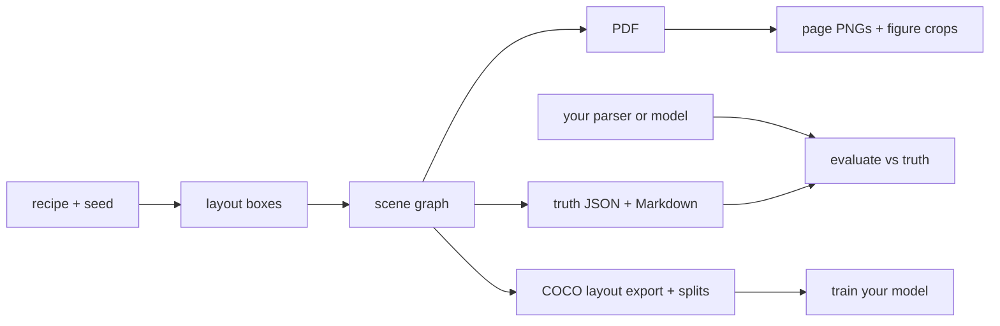

# synthetic-pdf-bench

Generate synthetic PDFs with exact labels, to train and evaluate Docling-style document models: layout detection, reading order, table structure and PDF-to-Markdown.

The truth (text, reading order, coordinates, tables, figures, Markdown spans) comes straight from the scene graph the PDF is rendered from. It is never recovered by parsing the output PDF, so it cannot be wrong.



## Quick start

```bash
uv sync
uv run synthetic-pdf-bench --output output/synthetic_000001 --seed 123 --recipe data/recipes/canonical/sea_historical_report_v1.json
```

This writes one document directory:

```text
output/synthetic_000001/
  document.pdf
  truth/
    document.json
    document.md
    manifest.json
    pages/page_001.png
    figures/*.png
```

The default generator loads the canonical Southeast Asia historical recipe from `data/recipes/canonical/sea_historical_report_v1.json` and naturally flows it across 3-8 pages. The layout planner creates deterministic boxes for titles, headings, paragraphs, tables, table cells, raster figures, vector figures, captions, repeated headers, footers, and page numbers.

## Dataset generation

Generate a small dataset with deterministic seeds and recipe/layout variants:

```bash
uv run synthetic-pdf-bench \
  --output-root output/small_dataset \
  --count 5 \
  --seed-start 100 \
  --recipe data/recipes/canonical/sea_historical_report_v1.json \
  --variants standard compact text_heavy figure_heavy table_heavy
```

Dataset mode writes:

```text
output/small_dataset/
  manifest.json
  synthetic_000001/
  synthetic_000002/
  synthetic_000003/
```

Available variants are `standard`, `compact`, `spacious`, `text_heavy`, `figure_heavy`, `table_heavy`, `two_column`, `random` and `structured`. `structured` turns some paragraphs into paragraph + list (one `list-item` box per item, with a hanging marker), paragraph + footnote (at the foot of the page, below a short rule) and paragraph + display formula (70% numbered, the number inside the formula box, as in DocLayNet), on a random page template, so all 11 layout classes occur. `random` samples a whole page template from the seed (page size, margins, type sizes, font family, 1 or 2 columns, page-number position) and records it in `truth/document.json` under `metadata.layout_style`.

Each document manifest includes a `quality` report. The dataset manifest includes aggregate `summary_stats` for pages, blocks, tables, figures, and variant counts.

## Layout features

The flow layout engine uses ReportLab font metrics for text height estimation and supports:

- one-column and two-column page flow
- repeated headers, footers, and page numbers
- section page-break hints
- paragraphs, lists, tables, figures, captions, footnotes, and references
- split table segments when a table does not fit in the current column/page
- figure captions before or after figures
- page-level validation for bounds and content-block overlap

## Visual benchmark recipe

`data/recipes/canonical/visual_benchmark_v1.json` exercises visual extraction with deterministic matplotlib chart figures and richer table shapes.

Supported matplotlib chart kinds:

- `bar_chart`
- `line_chart`
- `stacked_bar`
- `timeline`
- `scatter_plot`
- `heatmap`

Supported table variants:

- narrow table
- wide table
- numeric table
- multilingual table
- wrapped cell text
- merged cells (real `rowspan`/`colspan`: spanned positions have no cell of their own, and the table HTML carries the spans)
- multi-page table splitting

## Benchmark evaluation

Expected parser output directory shape:

```text
prediction/
  document.md          # predicted Markdown, optional if prediction.json has markdown
  prediction.json      # structured prediction
  figures/*.png        # optional extracted figure files
```

Minimal `prediction.json` shape:

```json
{
  "doc_id": "optional",
  "markdown": "# Predicted Markdown",
  "blocks": [
    {"block_id": "b000001", "type": "paragraph", "page_index": 0, "bbox_pt": [72, 100, 540, 130]}
  ],
  "tables": [
    {"table_id": "tbl_001", "matrix": [["A", "B"]], "page_index": 0, "bbox_pt": [72, 100, 540, 160]}
  ],
  "figures": [
    {
      "figure_id": "fig_001",
      "page_index": 0,
      "bbox_pt": [72, 200, 540, 360],
      "markdown_ref": "",
      "png_path": "figures/fig_001.png"
    }
  ]
}
```

Run the evaluator:

```bash
uv run synthetic-pdf-bench evaluate \
  --truth output/synthetic_000001/truth \
  --prediction path/to/parser/output \
  --output output/synthetic_000001/evaluation.json
```

Metrics include normalized Markdown exact match, table TEDS (a `tables[].html` string in the prediction also scores row/column spans), Markdown token F1, Markdown edit similarity (token-level, 1 minus normalized Levenshtein), reading order (share of body block pairs ordered like the truth; blocks are matched by `block_id`, so a parser without our ids scores 0 until SYN-1 adds matching), block bbox IoU, table matrix exact match, figure count match, figure bbox IoU, and figure Markdown reference match.

Score a parser over a whole dataset (per-variant and per-split means in `benchmark.json`):

```bash
uv run synthetic-pdf-bench benchmark output/corpus --parser dummy --output output/bench          # truth copy: every metric 1.0
uv run synthetic-pdf-bench benchmark output/corpus --parser "my-parser {pdf} {out}" --output output/bench_mine
```

`--parser` is a shell command with `{pdf}`, `{truth}` (for self-tests only) and `{out}` placeholders; it must write the prediction shape above into `{out}`. A document where the command fails or its output cannot be scored counts as zero on every metric and is listed under `failed`.

Three ready-made adapters live in `scripts/parsers/` (each takes `PDF OUT_DIR` and writes `document.md`): `pymupdf_text.py`, `pypdf_text.py` and `docling_md.py` (needs `pip install docling`). They give Markdown-only predictions, so only the Markdown metrics are meaningful for them; block, table and figure metrics need `prediction.json`. `scripts/jobs/parser_benchmark.sh` runs all three on a CPU RunPod pod through `scripts/runpod_launch.sh`.

### Parser results (SYN-4, SYN-5)

30 generated documents (`standard` and `structured` variants, canonical recipes, repo `c714db2`), CPU pod with 8 vCPUs, `scripts/jobs/parser_benchmark.sh`. Every parser scored on all 30 with no failures. The adapters write Markdown only, so the block, table and figure metrics are 0 for all three by construction and are not shown.

| Parser | Markdown token F1 | Markdown edit similarity | Wall time, 30 docs |
|---|---|---|---|
| Truth copy (dummy) | 1.000 | 1.000 | 42 s |
| Docling (default pipeline, CPU) | 0.965 | 0.917 | 1,555 s |
| PyMuPDF text layer | 0.953 | 0.909 | 290 s |
| pypdf text layer | 0.953 | 0.909 | 295 s |

Read this as a first measurement, not a ranking. The synthetic PDFs have a clean text layer, so a plain text extractor already recovers almost every word: the Markdown metrics barely separate Docling (0.965) from PyMuPDF (0.953), and PyMuPDF and pypdf score the same. Wall time includes scoring (about 1.4 s per document, the dummy run), so Docling itself took about 40 s per document. What would separate parsers is structure: tables, reading order and block boxes need an adapter that writes `prediction.json`, and the `degraded` profiles (scans) need OCR. Both are open.

For smoke testing the evaluator, generate a truth-copy dummy prediction:

```bash
uv run synthetic-pdf-bench dummy-parse \
  --truth output/synthetic_000001/truth \
  --prediction output/synthetic_000001/dummy_prediction
```

## Parallel generation and leakage-safe splits

```bash
uv run synthetic-pdf-bench --output-root output/corpus --count 200 --workers 8 \
  --variants random standard --recipe data/recipes/canonical/a.json --recipe data/recipes/canonical/b.json \
  --splits train=0.8 val=0.1 test=0.1 --split-by recipe
uv run synthetic-pdf-bench export-coco output/corpus     # coco_train.json, coco_val.json, coco_test.json
```

`--splits` writes `splits.json` and tags each document in the manifest. Whole groups go to one split, chosen by `--split-by`: `recipe` (same text source, the default), `template` (same page layout), or `document` (can leak text across splits). With only a few groups the realized proportions are coarse (4 recipes cannot make a 90/5/5 split); if there are fewer groups than splits, generation fails instead of leaking. Output is identical for any `--workers` value.

## Scan degradation

```bash
uv run synthetic-pdf-bench --output output/scan_1 --seed 3 --degrade heavy_scan   # or light_scan
```

Page images get per-page skew, shift, contrast loss, blur, noise and JPEG artifacts. `document.pdf` becomes an image-only scan (no text layer, so OCR is needed) and the digital original is kept as `document_clean.pdf`. `bbox_px` in the truth and COCO export follow the degraded pages; `bbox_pt` and `bbox_norm` still describe the digital PDF, and figure crops stay clean. Boxes are axis-aligned around the skewed content, so they are a little looser than the text.

## Line and word boxes

Every text block in `truth/document.json` carries `lines`, each with its text, `bbox_pt`, `bbox_px` and `words` (text and boxes; CJK characters are one word each), for training or scoring text recognition. The PDF is drawn from these same lines, so they match the page exactly, and under `--degrade` the `bbox_px` values follow the skew. Boxes run from font descent to ascent, so they are a little taller than the glyphs. Table cells and figure text are not covered yet.

## Layout-detection export

```bash
uv run synthetic-pdf-bench export-coco output/small_dataset   # writes output/small_dataset/coco.json
```

Boxes use DocLayNet-style classes, with a per-page `reading_order` on each annotation.

## Training exports

```bash
uv run synthetic-pdf-bench export-yolo output/corpus   # output/corpus/yolo: images/, labels/, data.yaml
uv run synthetic-pdf-bench export-hf output/corpus     # output/corpus/hf: <split>/ images + metadata.jsonl, README.md card
```

Both follow `splits.json` when it exists (otherwise everything goes in `train`) and use the same boxes and classes as `export-coco`. The Hugging Face output is an imagefolder, so `load_dataset("imagefolder", data_dir="output/corpus/hf")` reads it; each row has `objects` with `bbox` (COCO `[x, y, w, h]`), `category` and `reading_order`.

## Table-structure export

```bash
uv run synthetic-pdf-bench export-tables output/small_dataset   # writes output/small_dataset/tables.jsonl
```

One JSON line per table segment, in the PubTabNet layout that table-structure models train on: the page image, the table box in page pixels, HTML structure tokens (with `rowspan`/`colspan`), and each cell's characters and pixel box. A table split across pages is one record per segment.

## Train a layout model

`scripts/train_layout.py` fine-tunes YOLOX-Tiny (Apache-2.0, COCO weights) on the COCO export and reports per-class mAP, with the hardware it ran on. The training stack is optional and pinned by commit, so it needs a venv rather than `uv sync`:

```bash
uv venv .venv-train && uv pip install --python .venv-train/bin/python torch --index-url https://download.pytorch.org/whl/cpu   # or a CUDA build
uv pip install --python .venv-train/bin/python "rtod[torch,coco] @ git+https://github.com/leejianrong/real-time-object-detection@3751bc7146a7491152facc6d6fb31b0544f37a69" -e .
.venv-train/bin/python scripts/train_layout.py --root output/corpus --train-json output/corpus/coco_train.json \
  --val-json output/corpus/coco_val.json --out output/run1 --steps 2000
```

Add `--steps 6 --batch 2 --size 416` for a CPU smoke run, and `--also-eval ROOT:JSON` (repeatable) to score the same model on other pages, such as sampled real ones. `report.json` carries train and eval seconds and the hardware; `scripts/jobs/layout_measure.sh` is the GPU job that measures speed and memory for sizing a run. `--also-train ROOT:JSON:SHARE` (repeatable) mixes in another train set, such as real pages, taking that share of the draws; `--augment` adds mild photometric jitter and zoom-out. Pages are not flipped during training because mirrored text is not a page. `tests/test_train_layout.py` runs a 2-step rehearsal and is skipped when the stack is missing.

## Real pages for evaluation

`scripts/prepare_doclaynet.py` samples pages from DocLayNet-v1.2 (CDLA-Permissive-1.0) into the same COCO layout. The parquet shards are sorted by document category, so it draws an equal seeded quota from evenly spaced shards and logs the category mix. `scripts/runpod_launch.sh` runs such a job on a RunPod pod under a total spend cap (`TOTAL_CAP_USD`, default 5) with a ledger in `output/runpod/spend.jsonl`; `scripts/jobs/doclaynet_prep.sh` is the pod side.

`scripts/eval_docling_layout.py` scores Docling's layout model (Apache-2.0) on the same pages with the same scorer; results and the class mapping are in [docs/layout-baselines.md](docs/layout-baselines.md).

## Quality controls

Generation runs quality validation before writing the final manifest. The checks verify:

- all blocks have bounding boxes
- included Markdown blocks have valid spans
- figure caption links resolve
- table cells stay inside table bounding boxes
- content blocks do not overlap
- rendered page images exist and are nonblank
- figure crops exist and are nonblank

## Fonts

The ReportLab renderer automatically uses the built-in `STSong-Light` CID font for text containing Chinese characters. Latin-only text uses Helvetica by default. Future phases can add configurable external fonts such as Noto Sans CJK for higher visual fidelity.

## Contributing

See [CONTRIBUTING.md](CONTRIBUTING.md).

## License

[Apache 2.0](LICENSE)
