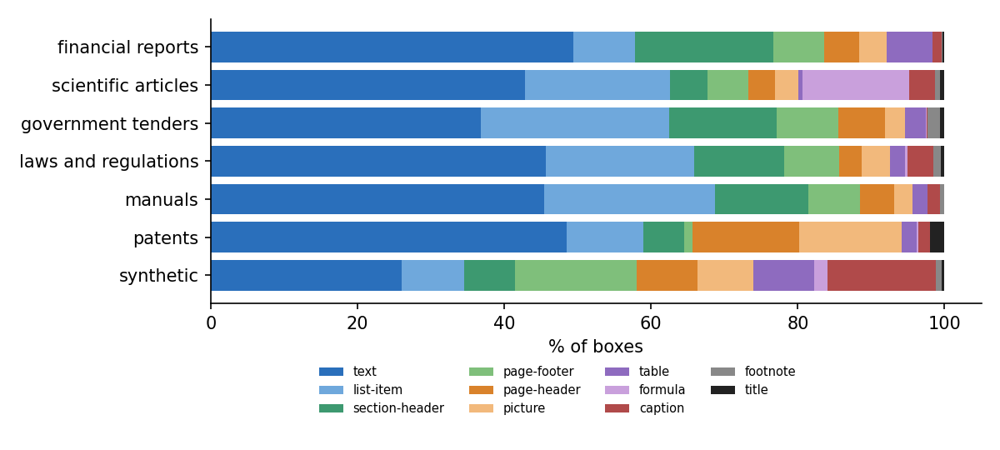
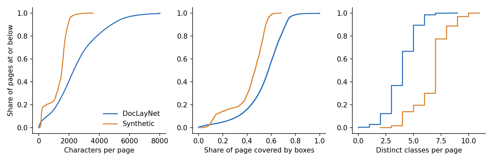
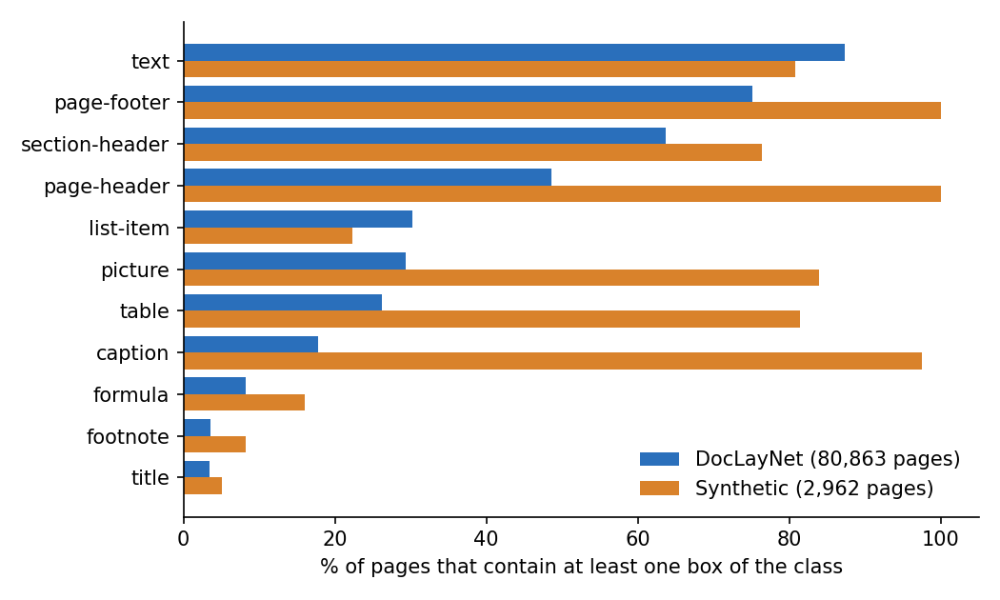
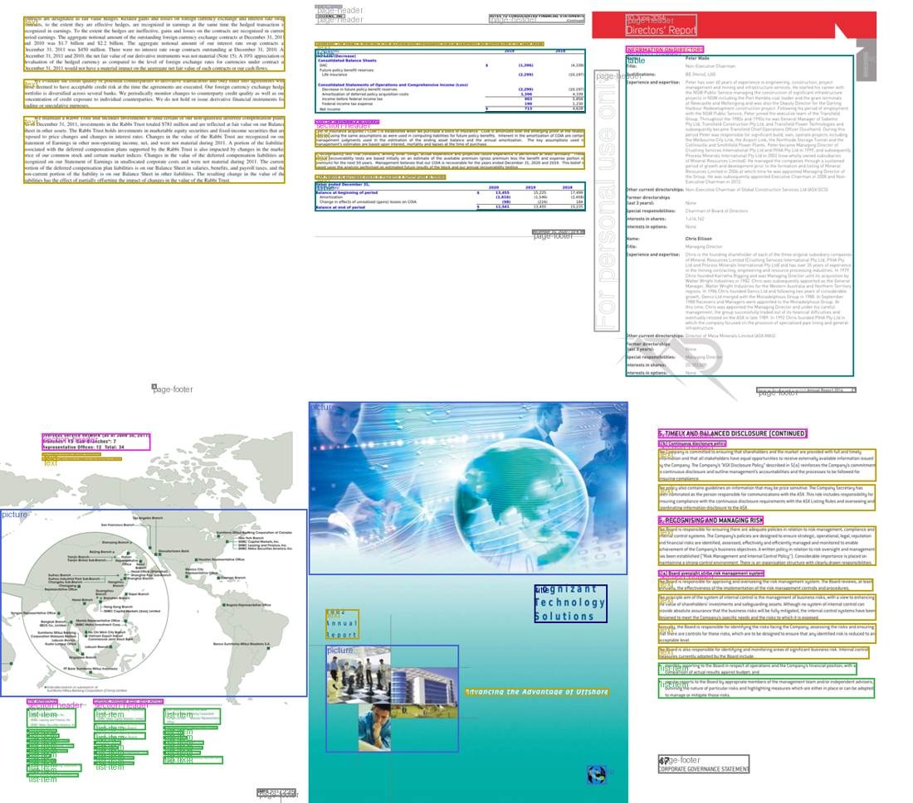
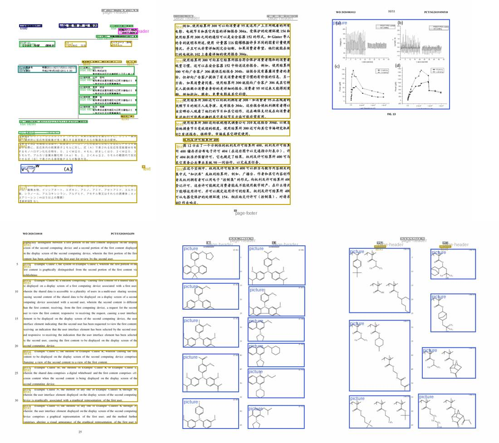
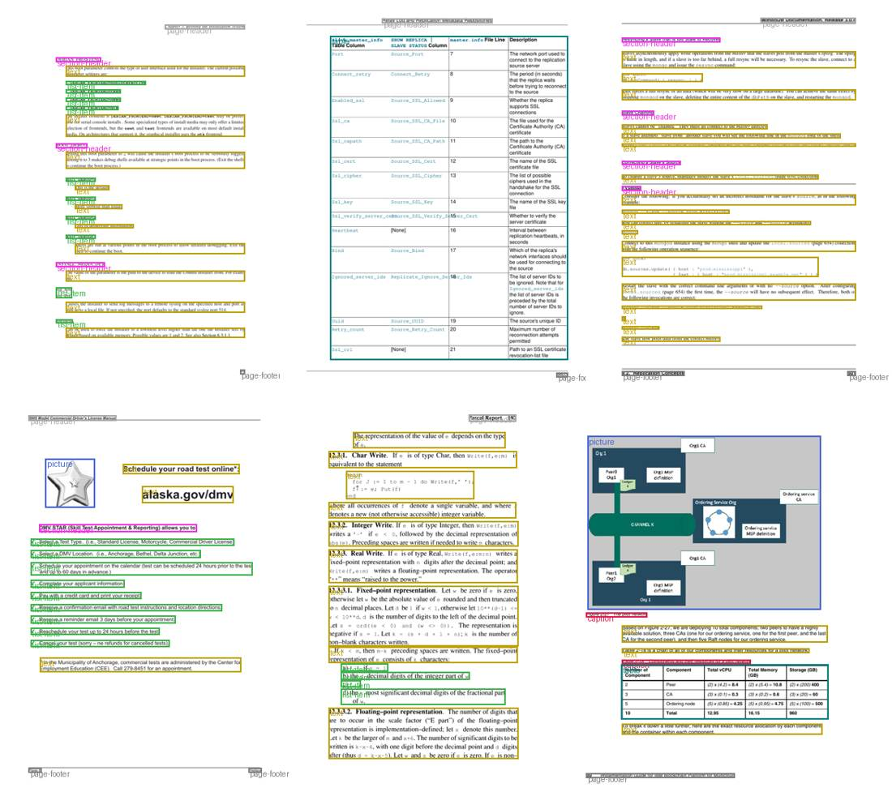
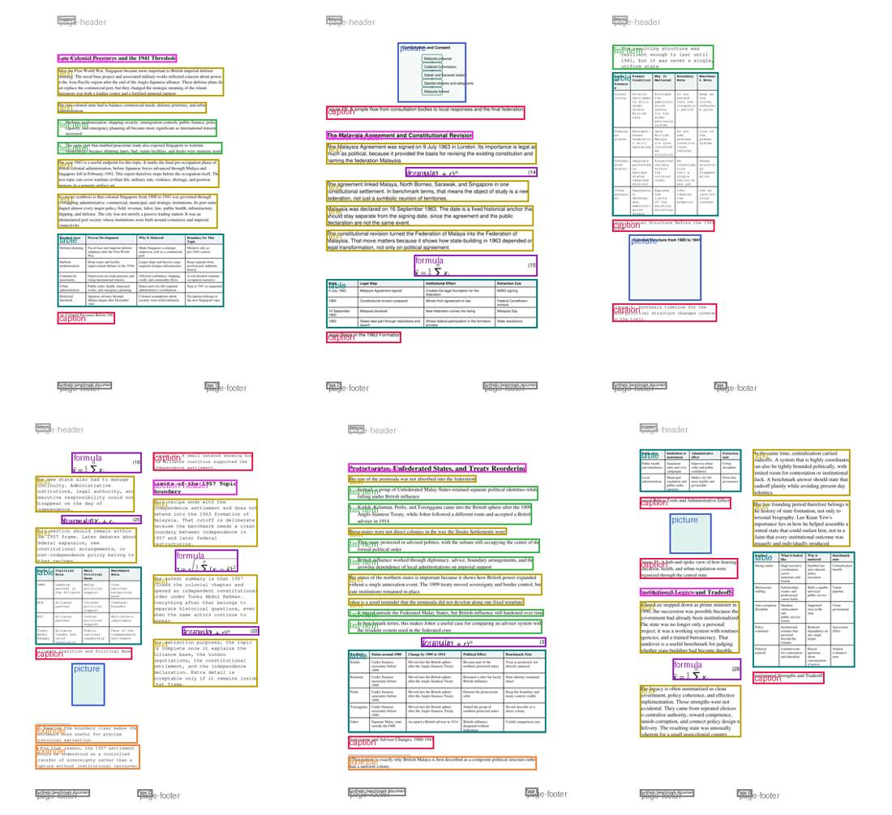

# DocLayNet against our synthetic pages (SYN-39)

What DocLayNet-v1.2 contains, how far our synthetic pipeline is from it, and what to change. Every number below comes from `scripts/doclaynet_survey.py` and `scripts/doclaynet_analysis.py` (commands at the end) run over all 80,863 real pages and over 2,962 synthetic pages (150 documents, the `random`, `standard` and `structured` variants of the 7 canonical recipes, the same mix the training runs used).

## Summary

1. **Our pages are a different kind of page, not a rougher copy of real ones.** A real page is mostly text plus a little furniture: median 4 distinct classes, a caption on 18% of pages, a table on 26%, a picture on 29%. Ours carry 7 classes: a header and footer on every page, a caption on 98%, a picture on 84%, a table on 81%.
2. **Real pages are about twice as dense.** Median 2,308 characters per page against 1,526; the 90th percentile is 4,808 against 1,931. Our 90th-percentile page is sparser than the median real page.
3. **Page furniture, titles and headings are the least realistic parts** (18 of the 25 largest gaps). Our headers and footers are one fixed size and place; our titles are about five times too large by area.
4. **DocLayNet is six genres, not one.** Class mix, fonts, page size and layout differ sharply by category (patents are 14% pictures and 14% page-headers; scientific articles are 14.5% formulas and 90% LaTeX type; manuals, tenders and laws are 20 to 26% list items). Ours is one genre, narrative history, from 7 recipes.
5. **Not among the large gaps:** boxes per page (median 13 against 12), table size, median text height, bold headings, page aspect ratio, nesting (annotators were not allowed overlapping boxes), landscape pages (2%).
6. **The pattern fits the detector results but does not prove them.** Classes that differ most from real (page-footer, page-header, title, footnote) are among the worst scored by our synthetic-only detector (Spearman rho -0.47 over 11 classes, too few to call significant). It also fits why SYN-38 changed nothing: it adjusted the geometry of text and pictures, the classes already closest to real.

The recommendations (last section) start with the cheapest changes that address the largest gaps, with a measurement rule for each, and with a larger option, generating pages on top of real box layouts, that would tell us how much of the gap is layout and how much is appearance.

## What DocLayNet contains

### Corpus structure

| | Pages | Documents | Collections | Letter | A4 | Other size |
|---|---|---|---|---|---|---|
| DocLayNet (all) | 80,863 | 2,943 | 27 | 50% | 28% | 22% |
| Synthetic (150 docs) | 2,962 | 150 | 7 | 71% | 29% | 0% |

Splits are 69,375 train, 6,489 validation and 4,999 test pages, as in the paper. Pages are heavily clustered by document, so the effective sample is smaller than the page count suggests:

| Category | Pages | Documents | Collections | Boxes / page (p10 / p50 / p90) | Characters / page (p50) | Coverage (p50) | Mean text columns | Letter / A4 / other |
|---|---|---|---|---|---|---|---|---|
| financial_reports | 26,129 | 488 | 3 | 4 / 12 / 22 | 2916 | 0.57 | 1.25 | 39% / 27% / 34% |
| government_tenders | 4,360 | 271 | 2 | 4 / 15 / 23 | 2420 | 0.61 | 0.93 | 1% / 87% / 12% |
| laws_and_regulations | 12,659 | 574 | 9 | 4 / 14 / 25 | 2395 | 0.64 | 1.33 | 21% / 34% / 46% |
| manuals | 17,024 | 129 | 2 | 5 / 16 / 26 | 2051 | 0.53 | 1.13 | 64% / 20% / 16% |
| patents | 6,574 | 498 | 8 | 4 / 11 / 28.7 | 1548 | 0.58 | 1.15 | 61% / 37% / 1% |
| scientific_articles | 14,117 | 983 | 3 | 4 / 10 / 22 | 2078 | 0.60 | 1.26 | 89% / 10% / 1% |

Manuals are 129 documents averaging 132 pages each; financial reports are 488 documents. Any statistic over pages is really a statistic over a few hundred documents per category. Per the paper, about 95% of documents are English, with German (2.5%), French (1%) and Japanese (1%); the dataset has no language field, so I could not measure it. Page size: 50% Letter, 28% A4, 22% other; landscape pages are 2%.

### Class mix by category

Each cell is the share of boxes, with the share of pages that contain the class in brackets.

| Category | text | list-item | section-header | page-footer | page-header | picture | table | formula | caption | footnote | title |
|---|---|---|---|---|---|---|---|---|---|---|---|
| financial_reports | 49.5 (91) | 8.3 (18) | 18.9 (80) | 6.9 (76) | 4.8 (47) | 3.7 (24) | 6.2 (49) | 0.0 (0) | 1.3 (8) | 0.2 (1) | 0.2 (2) |
| government_tenders | 36.8 (75) | 25.7 (49) | 14.6 (76) | 8.3 (87) | 6.5 (53) | 2.7 (25) | 2.8 (31) | 0.1 (1) | 0.1 (1) | 1.7 (14) | 0.6 (5) |
| laws_and_regulations | 45.7 (84) | 20.2 (36) | 12.2 (62) | 7.5 (88) | 3.1 (32) | 3.9 (33) | 2.0 (16) | 0.4 (2) | 3.5 (30) | 1.0 (6) | 0.5 (4) |
| manuals | 45.4 (91) | 23.3 (56) | 12.8 (68) | 7.0 (93) | 4.7 (61) | 2.5 (25) | 2.1 (19) | 0.0 (0) | 1.7 (18) | 0.6 (3) | 0.0 (1) |
| patents | 48.5 (77) | 10.4 (19) | 5.6 (24) | 1.1 (16) | 14.5 (76) | 14.0 (60) | 2.0 (14) | 0.2 (2) | 1.6 (14) | 0.0 (0) | 2.0 (7) |
| scientific_articles | 42.8 (88) | 19.8 (18) | 5.1 (44) | 5.5 (64) | 3.7 (38) | 3.2 (28) | 0.5 (6) | 14.5 (44) | 3.5 (31) | 0.8 (5) | 0.6 (7) |
| synthetic | 26.0 (81) | 8.5 (22) | 6.9 (76) | 16.6 (100) | 8.3 (100) | 7.6 (84) | 8.4 (81) | 1.8 (16) | 14.7 (98) | 0.8 (8) | 0.4 (5) |
| **all real** | 46.1 (87) | 16.8 (30) | 12.9 (64) | 6.4 (75) | 5.2 (49) | 4.2 (29) | 3.1 (26) | 2.3 (8) | 2.0 (18) | 0.6 (4) | 0.5 (3) |



Reading the table by category:

- **Financial reports:** section headers are 19% of boxes (on 80% of pages), tables 6% (49% of pages), almost no formulas or footnotes.
- **Scientific articles:** formulas are 14.5% of boxes and on 44% of pages, tables only 0.5% (6% of pages), and 90% of type is LaTeX Computer Modern. The footer class appears on 64% of pages.
- **Patents:** page-header is 14.5% of boxes and picture 14% (chemical structures, drawings), while only 16% of pages have a page-footer. Text can be Chinese or Japanese.
- **Laws, manuals and tenders:** list items are 20 to 26% of boxes (tenders: on 49% of pages). Laws and scientific articles have captions on about 30% of pages; laws are 46% non-Letter, non-A4. Tenders are 87% A4 and have the most footnotes (14% of pages).

### Page-level structure

| Measure | DocLayNet | Synthetic | KS |
|---|---|---|---|
| Boxes per page | 4 / 13 / 24 | 5 / 12 / 18 | 0.18 |
| Distinct classes per page | 2 / 4 / 6 | 4 / 7 / 9 | 0.70 |
| Share of page covered by boxes | 0.325 / 0.5763 / 0.7194 | 0.135 / 0.4656 / 0.555 | 0.46 |
| Characters per page | 556.2 / 2308 / 4808 | 176 / 1526 / 1931 | 0.53 |
| Top margin (first box) | 0.0282 / 0.0583 / 0.1117 | 0.0404 / 0.0429 / 0.0429 | 0.74 |
| Bottom margin (last box) | 0.0233 / 0.0464 / 0.1424 | 0.0451 / 0.048 / 0.048 | 0.48 |
| Left margin | 0.0339 / 0.1036 / 0.1504 | 0.0915 / 0.1013 / 0.1928 | 0.36 |
| Right margin | 0.0363 / 0.0952 / 0.1407 | 0.0948 / 0.1226 / 0.2083 | 0.45 |
| Font families per page | 1 / 1 / 2 | 1 / 1 / 1 | 0.43 |
| Gap to the box below (pt) | 2.28 / 11 / 30.8 | 7 / 11 / 111 | 0.28 |





### Geometry and type size per class

Width and height are shares of the page; type height is the median text-cell height in points (a proxy for font size: DocLayNet's own size field is a scale factor, not points). Synthetic tables, pictures and formulas have no text cells, so no type height.

| Class | Boxes (real) | Width real | Width synthetic | Height real | Height synthetic | Type height real (pt) | Type height synthetic (pt) |
|---|---|---|---|---|---|---|---|
| text | 510,377 | 0.19 / 0.43 / 0.8 | 0.35 / 0.63 / 0.8 | 0.011 / 0.042 / 0.15 | 0.03 / 0.061 / 0.12 | 7.65 / 9.4 / 12.9 | 8.16 / 9.18 / 11.2 |
| list-item | 185,660 | 0.18 / 0.42 / 0.76 | 0.33 / 0.37 / 0.65 | 0.011 / 0.022 / 0.058 | 0.017 / 0.043 / 0.072 | 8.07 / 9.52 / 13.3 | 8.16 / 9.18 / 11.2 |
| section-header | 142,884 | 0.077 / 0.21 / 0.48 | 0.3 / 0.4 / 0.59 | 0.01 / 0.014 / 0.025 | 0.019 / 0.02 / 0.04 | 7.92 / 10.9 / 15.7 | 11.2 / 13.3 / 14.3 |
| page-footer | 70,878 | 0.012 / 0.034 / 0.3 | 0.041 / 0.12 / 0.19 | 0.0094 / 0.012 / 0.016 | 0.017 / 0.018 / 0.018 | 7.32 / 9.4 / 12.3 | 8.16 / 8.16 / 8.16 |
| page-header | 58,022 | 0.014 / 0.14 / 0.39 | 0.052 / 0.058 / 0.11 | 0.01 / 0.013 / 0.035 | 0.019 / 0.02 / 0.02 | 7.83 / 9.96 / 14.1 | 8.16 / 8.16 / 8.16 |
| picture | 45,976 | 0.094 / 0.33 / 0.75 | 0.16 / 0.28 / 0.5 | 0.038 / 0.17 / 0.55 | 0.11 / 0.14 / 0.17 | 5.67 / 7.56 / 16.4 | - |
| table | 34,733 | 0.37 / 0.76 / 0.88 | 0.36 / 0.65 / 0.81 | 0.063 / 0.16 / 0.63 | 0.094 / 0.15 / 0.27 | 6.84 / 8.97 / 12 | - |
| formula | 25,027 | 0.26 / 0.4 / 0.63 | 0.14 / 0.27 / 0.42 | 0.016 / 0.038 / 0.085 | 0.021 / 0.038 / 0.053 | 8.85 / 9.96 / 12 | - |
| caption | 22,524 | 0.11 / 0.33 / 0.76 | 0.21 / 0.34 / 0.66 | 0.011 / 0.015 / 0.078 | 0.029 / 0.033 / 0.037 | 7.58 / 9.25 / 11.2 | 7.14 / 8.16 / 10.2 |
| footnote | 6,318 | 0.17 / 0.41 / 0.76 | 0.33 / 0.36 / 0.64 | 0.0087 / 0.012 / 0.041 | 0.016 / 0.033 / 0.058 | 7.13 / 7.28 / 11 | 7.14 / 8.16 / 10.2 |
| title | 5,071 | 0.15 / 0.34 / 0.74 | 0.33 / 0.61 / 0.79 | 0.013 / 0.018 / 0.06 | 0.052 / 0.056 / 0.11 | 8.51 / 12.4 / 23.4 | 16.3 / 18.4 / 19.4 |

What stands out: text and table boxes are close; section headers (median width 0.21 against 0.40, type 10.9 pt against 13.3 pt), titles (area 0.007 against 0.035) and furniture (a footer is 0.012 of the page tall, ours 0.018, always 8.16 pt type) are not. A real title is not a display heading: its median type height is 12.4 pt and it is on 3% of pages.

### Typography

Share of boxes with text, by font family (families grouped from the font name in each PDF):

| | times | helvetica | latex | sans-other | serif-other | dejavu | calibri | mono | other |
|---|---|---|---|---|---|---|---|---|---|
| financial_reports | 9 | 16 | 0 | 27 | 14 | 14 | 1 | 0 | 19 |
| government_tenders | 45 | 23 | 0 | 19 | 0 | 0 | 8 | 0 | 5 |
| laws_and_regulations | 54 | 19 | 0 | 2 | 8 | 10 | 1 | 0 | 5 |
| manuals | 18 | 56 | 0 | 5 | 7 | 0 | 1 | 5 | 9 |
| patents | 77 | 18 | 0 | 0 | 0 | 0 | 0 | 0 | 4 |
| scientific_articles | 8 | 1 | 90 | 0 | 0 | 0 | 0 | 0 | 1 |
| **all real** | 26 | 25 | 14 | 11 | 7 | 6 | 1 | 1 | 10 |
| synthetic | 32 | 59 | 0 | 0 | 0 | 0 | 0 | 9 | 0 |

Two thirds of real text is not Helvetica or Times, and it depends on the category: scientific articles are 90% LaTeX Computer Modern, manuals 56% Helvetica, patents 77% Times. Bold is common where it should be: 72% of section headers, 78% of titles, 30% of captions and 32% of page headers are bold. Our headings are bold too (the renderer draws them so), but our captions and page headers never are.

### Spacing, margins, conventions

- **Gaps between stacked boxes:** the median gap is 11 pt in both, but real pages have many more tight ones (10th percentile 2.3 pt against 7.0 pt), and ours have a long tail of empty space (90th percentile 111 pt against 31 pt), mostly the end of a section.
- **Margins:** the first box starts at a median 5.8% from the top in real pages, with a spread from 2.8% to 11.2%. Ours start between 4.0% and 4.3% on 80% of pages because the header is always at the same place.
- **Overlap:** boxes never nest (the paper: annotators could only draw non-overlapping rectangles), but there are 0.12 partial overlaps per page on average (two boxes crossing by 5 to 80% of the smaller one). Ours have none.
- **Reference lists** in scientific articles are annotated as one list item per entry; our generator emits them as `text`.

## What the pages look like

Six random pages per category (seeded, not chosen), boxes drawn by class. Three of the six sheets are in this folder; the rest are reproducible with `scripts/doclaynet_contact_sheet.py`.



Financial reports mix dense small-print paragraphs with a page-wide table carrying a rotated watermark, a cover where one picture fills the page and the title sits on top of it, a map with tiny list items in three columns beneath, tinted backgrounds, and bold table headers.



Patents: Chinese and Japanese text, pages made almost entirely of chemical-structure pictures with line numbers in the margin, numbered claim paragraphs, and form-like cover pages where each field is a list item.



Manuals: monospace code mixed into running text, run-in headings, numbered steps as list items, tinted tables with coloured text, diagrams on grey backgrounds, a mascot icon next to a URL.



Ours, for comparison: white pages of identical small type, a header and a footer in the same corner every time, a table, a caption and a pale picture on most pages, paragraphs of similar length, large empty areas at the page bottom.

What the real pages have that the pipeline cannot produce today, from these 18 pages: boxes touching or overlapping slightly; text that mixes faces and sizes inside one page (code, bold run-in headings, italic); coloured and tinted regions; pictures that fill the page or sit behind text; rotated watermark text; very short text boxes (single clauses or lines); lists of tiny items in several narrow columns; non-Latin scripts; page numbers and headers in many forms.

## How far apart, ranked

The Kolmogorov-Smirnov distance is the largest gap between the two cumulative distributions: 0 identical, 1 disjoint. It sees differences in spread and shape that a median hides, but not joint structure (a page can have the right class mix and the wrong layout).

| Rank | Measure | KS | DocLayNet p10 / p50 / p90 | Synthetic p10 / p50 / p90 |
|---|---|---|---|---|
| 1 | page-footer.height | 0.92 | 0.0094 / 0.0118 / 0.0159 | 0.0166 / 0.0177 / 0.0177 |
| 2 | page.count_page-footer | 0.89 | 0 / 1 / 2 | 2 / 2 / 2 |
| 3 | page-header.text_height_pt | 0.89 | 7.83 / 9.96 / 14.1 | 8.16 / 8.16 / 8.16 |
| 4 | title.height | 0.84 | 0.0129 / 0.0185 / 0.0604 | 0.0523 / 0.0556 / 0.111 |
| 5 | page-header.height | 0.82 | 0.0102 / 0.0128 / 0.0351 | 0.019 / 0.0202 / 0.0202 |
| 6 | page-footer.text_height_pt | 0.82 | 7.32 / 9.4 / 12.3 | 8.16 / 8.16 / 8.16 |
| 7 | section-header.height | 0.81 | 0.0102 / 0.0141 / 0.0245 | 0.019 / 0.0202 / 0.0404 |
| 8 | title.text_height_pt | 0.80 | 8.51 / 12.4 / 23.4 | 16.3 / 18.4 / 19.4 |
| 9 | page.count_caption | 0.80 | 0 / 0 / 1 | 1 / 2 / 2 |
| 10 | title.area | 0.78 | 0.0023 / 0.0071 / 0.0368 | 0.0278 / 0.0353 / 0.044 |
| 11 | section-header.area | 0.76 | 0.0009 / 0.003 / 0.0094 | 0.007 / 0.0107 / 0.0146 |
| 12 | page.top_margin | 0.74 | 0.0282 / 0.0583 / 0.112 | 0.0404 / 0.0429 / 0.0429 |
| 13 | page.classes_per_page | 0.70 | 2 / 4 / 6 | 4 / 7 / 9 |
| 14 | page-footer.cy | 0.66 | 0.908 / 0.949 / 0.972 | 0.943 / 0.943 / 0.947 |
| 15 | caption.height | 0.66 | 0.0105 / 0.0151 / 0.0778 | 0.0285 / 0.0333 / 0.0366 |
| 16 | page-footer.area | 0.63 | 0.0001 / 0.0004 / 0.0038 | 0.0007 / 0.002 / 0.0032 |
| 17 | footnote.height | 0.63 | 0.0087 / 0.0118 / 0.0408 | 0.0158 / 0.0328 / 0.0576 |
| 18 | page-footer.width | 0.61 | 0.012 / 0.0337 / 0.298 | 0.0414 / 0.117 / 0.188 |
| 19 | section-header.width | 0.60 | 0.077 / 0.212 / 0.483 | 0.3 / 0.405 / 0.595 |
| 20 | section-header.text_height_pt | 0.57 | 7.92 / 10.9 / 15.7 | 11.2 / 13.3 / 14.3 |
| 21 | title.cy | 0.56 | 0.0748 / 0.118 / 0.284 | 0.134 / 0.146 / 0.176 |
| 22 | page.count_table | 0.55 | 0 / 0 / 1 | 0 / 1 / 2 |
| 23 | footnote.text_height_pt | 0.55 | 7.13 / 7.28 / 11 | 7.14 / 8.16 / 10.2 |
| 24 | page.count_picture | 0.55 | 0 / 0 / 2 | 0 / 1 / 1 |
| 25 | page-header.cy | 0.55 | 0.0347 / 0.0566 / 0.125 | 0.0499 / 0.053 / 0.053 |

Of the 25, 18 are about furniture (10), titles (4) or section headers (4), 4 are the number of boxes of a class per page (captions, tables, pictures, classes overall), and 3 are caption and footnote sizes. Table size, median text size and the number of boxes per page are not in the list.

### Does the gap track the detector?

Mean distance over width, height, area, vertical position, type height and aspect, against the test AP of the synthetic-only detector (mean of six runs, 3 seeds before and 3 after SYN-38, which did not differ):

| Class | Mean KS | Test AP | Pages with class: real | synthetic |
|---|---|---|---|---|
| page-footer | 0.69 | 0.020 | 75% | 100% |
| page-header | 0.65 | 0.013 | 49% | 100% |
| title | 0.64 | 0.025 | 3% | 5% |
| section-header | 0.52 | 0.056 | 64% | 76% |
| footnote | 0.50 | 0.003 | 4% | 8% |
| caption | 0.38 | 0.010 | 18% | 98% |
| list-item | 0.32 | 0.018 | 30% | 22% |
| formula | 0.32 | 0.018 | 8% | 16% |
| picture | 0.25 | 0.090 | 29% | 84% |
| text | 0.25 | 0.161 | 87% | 81% |
| table | 0.23 | 0.074 | 26% | 81% |

The three best-scoring classes are the three closest to real, and the four most distant are among the worst. Spearman rho is -0.47 over 11 classes, which is not statistically significant, and caption (distance only 0.38, AP 0.010) is a miss for geometry alone: it appears on 98% of our pages and 18% of real ones. For scale, the paper's human inter-annotator agreement is mAP 0.82 to 0.83 overall, and as low as 0.60 to 0.72 for titles and 0.69 to 0.71 for pictures, so those classes cannot score highly anywhere.

SYN-38 narrowed the picture area (0.080 to 0.045 of the page) and the text width (0.77 to 0.66) and the score did not move (0.0447 to 0.0442, seed range 0.005). Text and picture were already the best-matched classes; the poorly scored ones were not touched. That is an explanation consistent with the data, not a tested one.

## What to change

Ordered by gap size per unit of work. Each item says what it fixes, how it is measured, and what would show it does not help. All score changes are judged on the three-seed synthetic-only test mAP50-95 (baseline 0.0447, range 0.0055); a change counts only if its mean moves by more than 0.01, twice the range. Per-category test scores should be added to the job first, since the test set carries the category and the aggregate hides where a change helps.

1. **Page composition and furniture (largest gap, about 3 to 5 days).** Draw each page's class set from the category's real presence rates instead of building every page from the same blocks: caption only beside a figure or table; a table on about a quarter of pages, a picture on 29%; a header on about half of pages, a footer on three quarters, usually one box. Make furniture per document, not fixed: type 7 to 14 pt, width from 1% to 40% of the page, position varying, page numbers alone or with text. Make titles small (12 pt median, on 3% of pages) and section headers short and tight (width 0.21, type 11 pt). Evidence: gaps 1 to 13 and 15 to 21 above. Test: class presence and furniture KS should fall below 0.3; score should move on page-footer, page-header, title, caption.
2. **Density (about 2 days).** Real pages carry up to 4,800 characters (90th percentile). Allow smaller type (7 to 9 pt), tighter line and block spacing, a heavy-tailed text-box length (real: 10% under 34 characters, 10% over 640), and clause-per-box text for laws. Reference lists become list items. Test: characters-per-page and coverage KS below 0.3.
3. **Fonts (about 2 to 3 days).** ReportLab's three built-in faces cover only a third of real text. Matplotlib already ships DejaVu Sans, DejaVu Serif, STIX and Computer Modern TrueType files, so LaTeX-style pages (14% of real text, 90% of scientific articles) and DejaVu (6%) need no new dependency; Liberation (SIL OFL), if we vendor it, adds Arial and Times metrics. Choose a family profile per category. Caution: more font variety also changes line metrics, so text-line truth must be re-checked after the change.
4. **Genre profiles (about a week, includes SYN-8).** Add recipes or procedural content for the five missing genres (patents, scientific articles, laws, manuals, tenders), each with its class mix (table above), page size and column count, and keep narrative history as one genre among six. Use the category's real class mix as a sampling target and compare class share by category afterwards. This is where table-structure data would come from for financial pages.
5. **Layout replay (about a week, decision after 1 and 2).** Sample the box layouts of real training pages (classes and geometry only; no text or pixels), then fill each box with generated content of the right size: text wrapped to fit, tables sized to fit, a picture, a formula. This matches the joint structure by construction (composition, sizes, overlaps, columns), which marginal tuning cannot do, and it separates the question: if a detector trained on real layouts with synthetic appearance still scores far below real-only, the gap is appearance, not layout. Use only the train split's layouts, and disclose that they encode the train set's layout statistics. It is the most informative experiment and the most expensive.
6. **Appearance (after the above).** Full-bleed and background pictures, tinted tables and coloured headings, watermarks, partial box overlaps (0.12 per page), and CJK for patents and other non-English pages (about 5% of documents). Each is small alone; none was measured beyond a visual impression.

Stopping rule: if composition, density and fonts together do not take the synthetic-only score above about 0.09 (twice today's 0.045), stop trying to reach real-only parity and use synthetic data to supplement real data (mix and fine-tune arms) and for the structure labels real data lacks (table structure, reading order, Markdown), where the exact truth is the advantage.

## Limits of this analysis

- **Definitions differ slightly between corpora.** DocLayNet type height and character counts come from PDF text cells, ours from the scene graph lines. The headline gaps are far larger than that difference, but small ones should not be read.
- **The synthetic corpus is one draw** of 150 documents from 7 recipes; nothing here measures its own variation. The 0.005 detector noise is a measure of training noise on such a draw.
- **Distribution distance is not importance.** The ranking says where we differ, not which differences the detector depends on. Only ablations say that, and none has been run for these.
- **Qualitative review is 18 real pages.** It is a sample for ideas, not a measurement; the quantitative tables cover all pages.
- **The class-to-AP link rests on 11 points.** Treat it as a pattern to test.

## Reproduce

```bash
uv run --with pyarrow --with huggingface_hub python scripts/doclaynet_survey.py fetch --out output/doclaynet/survey --workers 3      # all 85 shards, about 5 minutes, no images downloaded
uv run synthetic-pdf-bench --output-root output/doclaynet/syn --count 150 --workers 3 --variants random standard structured \
  $(for f in data/recipes/canonical/*.json; do echo --recipe $f; done) --splits train=0.85 val=0.15 --split-by recipe
uv run python scripts/doclaynet_survey.py synthetic output/doclaynet/syn --out output/doclaynet/survey_synthetic.jsonl.gz
uv run python scripts/doclaynet_analysis.py --real output/doclaynet/survey --synthetic output/doclaynet/survey_synthetic.jsonl.gz \
  --out output/doclaynet/analysis.json --figures docs/img/doclaynet
uv run synthetic-pdf-bench export-coco output/doclaynet/syn
uv run --with pyarrow --with huggingface_hub python scripts/doclaynet_contact_sheet.py real --survey output/doclaynet/survey --out output/doclaynet/sheets
```

## Result of the page composition change (SYN-41)

Random and structured pages now vary their furniture per document (header on about half, footer as none, number only, text only or both, type 7 to 14 pt, varied offsets and alignment, tight boxes), draw titles and headings smaller with line heights that follow the type size, keep only a share of tables and figures and fewer captions, and size captions to their text. The standard style is unchanged. Measured the same way as above, on 150 documents of the `random` and `structured` variants against all of DocLayNet:

| Pages with the class | DocLayNet | Before | After |
|---|---|---|---|
| page-footer | 75% | 100% | 71% |
| page-header | 49% | 100% | 56% |
| caption | 18% | 97% | 20% |
| picture | 29% | 80% | 36% |
| table | 26% | 78% | 33% |

Distribution distance (KS) fell on the targeted measures: classes per page 0.67 to 0.25, footers per page 0.89 to 0.04, captions per page 0.79 to 0.05, caption height 0.66 to 0.29, page-header type height 0.89 to 0.21, title type height 0.80 to 0.29, top margin 0.74 to 0.30. The mean over all measures went from 0.404 to 0.284. What did not move: title and section-header area and width (about 0.52 to 0.57) and character counts, because the recipe titles and headings are long sentences, not the 25-character headings real pages have; that is a content gap for the genre profiles (SYN-44). Characters per page rose from 1,268 to 1,663 on average (real 2,552), so density (SYN-42) is still open. The effect on the detector score has not been measured yet.

## Layout replay (SYN-45)

Recommendation 5 is built: `--variants replay --layout-bank BANK` generates pages on the box layouts of real DocLayNet train pages (README, "Dataset generation"). By construction, composition, box sizes, positions, page sizes and the 0.12 partial overlaps per page match real pages, so the distribution gaps above are closed for the classes and geometry; what stays synthetic is the content (recipe prose, number-filled tables, noise pictures) and the look (three built-in fonts, one document font family chosen from the real document's most common font). Layouts come from the train split only; the bank is a sample of 100 documents per category (600 documents, 24,821 pages), built from the survey. The effect on the detector score is measured in `docs/layout-baselines.md` once the run exists.

## Result of the font change (SYN-43)

Four TrueType families that ship with matplotlib (DejaVu Sans, DejaVu Serif, STIX, Computer Modern) join the three built-in ones, and `random` styles pick a family in roughly the real proportions. A family that lacks a glyph for a text (Computer Modern misses an accented letter in the recipes) falls back per text to DejaVu Serif. Share of boxes with text, by family group, on 150 `random` and `structured` documents against DocLayNet:

| Family group | DocLayNet | Before | After |
|---|---|---|---|
| Times (Times, STIX) | 26% | 48% | 22% |
| Helvetica | 25% | 37% | 22% |
| LaTeX Computer Modern | 14% | 0% | 18% |
| DejaVu and other sans or serif | 24% | 0% | 29% |
| Monospace | 1% | 15% | 0% |
| Other | 10% | 0% | 8% |

What is not covered: real pages sometimes mix families on one page (code in a manual, a different heading face); every synthetic page still uses one, so the font-families-per-page distance stays at 0.43. The document-level family also does not follow the category yet (scientific articles are 90% Computer Modern; that comes with the genre profiles, SYN-44). The mean distance over all measures is unchanged (0.284 to 0.282), as fonts change the look more than the geometry the survey measures. The effect on the detector score has not been measured.

## Result of the density change (SYN-42)

Random and structured pages are set a little tighter (type 7 to 11 pt with more small sizes, line pitch 1.15 to 1.35 times the type size, block spacing 4 to 10 pt, at most 30 pt of extra margin on single-column pages instead of 70), about a tenth of the documents start every section on a new page instead of a quarter, the recipes' own forced page breaks are honoured in 0 to 40% of documents, 0 to 50% of paragraphs are cut into one or two sentence boxes (for the short text boxes of real pages), and reference entries are exported as `list-item`, as bibliographies are in DocLayNet. Tables and figures are kept less often (5 to 30% of them) because denser pages put the same ones on fewer pages.

Correction to an earlier note: the half-empty pages in the long structured document were not caused by the recipe forcing a page break before every section. Only 5 of that recipe's 35 sections ask for one (the key is present on all 35, which is what I counted). They came from the page template: `force_section_page_breaks` was on for a quarter of random documents, and then every section starts a new page, leaving a section's overflow alone on a page.

Measured against all of DocLayNet on 150 `random` and `structured` documents:

| Measure | DocLayNet | After SYN-41 and SYN-43 | After SYN-42 |
|---|---|---|---|
| Characters per page, mean | 2,552 | 1,663 | 2,240 |
| Characters per page, distance (KS) | | 0.33 | 0.14 |
| Share of page covered, distance (KS) | | 0.50 | 0.39 |
| Pages with a table | 26% | 33% | 31% |
| Pages with a picture | 29% | 35% | 35% |
| Mean distance over all measures | | 0.282 | 0.263 |

What is still off: classes per page (0.25 to 0.35, because denser pages hold more blocks), and the over-represented structured classes: section headers on 91% of pages (real 64%), formulas 35% (8%), footnotes 21% (4%), titles 10% (3%). Those come from the `structured` variant, which adds lists, formulas and footnotes to every recipe so that all 11 classes occur; setting class mix per genre belongs to SYN-44. The effect on the detector score has not been measured.
